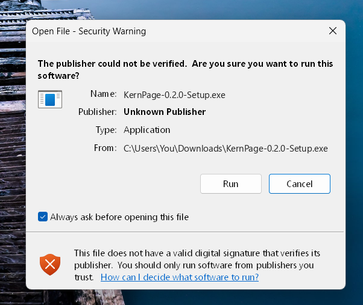
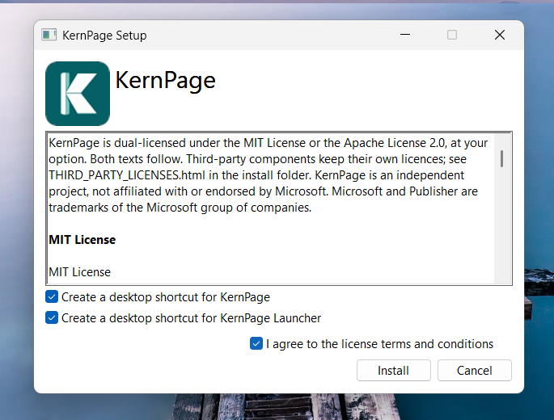
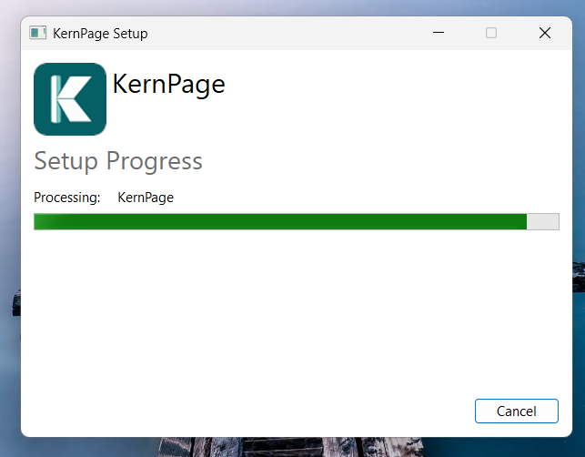
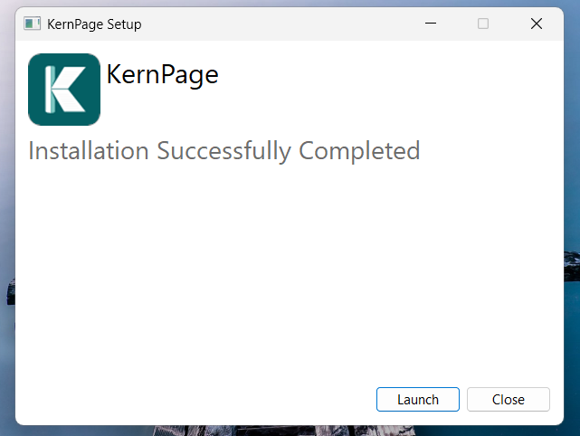
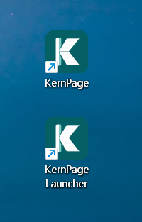

# Installing KernPage

KernPage is free. It runs on **Windows 10 or Windows 11 (64-bit)**. You don't need administrator
rights, because KernPage installs just for you, and you don't need an internet connection to use it.

## 1. Download the installer

Go to the **[latest release](https://github.com/jmitchell238/kernpage/releases/latest)** and download
**`KernPage-<version>-Setup.exe`** (for example `KernPage-0.2.0-Setup.exe`).

You can ignore the other files on that page:

| File | What it is |
|---|---|
| `KernPage-<version>-Setup.exe` | **The installer. This is the one you want.** |
| `KernPage-<version>-x64.msi` | The same program for IT departments that install on many computers at once. |
| `index.json`, `index.json.minisig` | The signed update list that the KernPage Launcher reads. You never open these yourself. |
| Source code | A copy of KernPage's code, for programmers. |

Only download KernPage from that release page. If you got the installer anywhere else, don't run it.

Your browser may say the file "isn't commonly downloaded". In Edge, open the downloads list, click
**…** next to the file, choose **Keep**, then **Show more** and **Keep anyway**.

## 2. Windows will warn you first

**Every new user sees a warning once. It is expected, and it is safe to continue.** KernPage isn't
signed with a paid certificate yet, so Windows doesn't know who made it. You will see one of these:

**The "Open File - Security Warning" window.** It says "The publisher could not be verified" and
"Unknown Publisher". Check that the name is `KernPage-<version>-Setup.exe`, then click **Run**.

**Or a blue "Windows protected your PC" box.** It has no Run button at first:

1. Click the small **More info** link under the message.
2. Check that the app is `KernPage-<version>-Setup.exe` and the publisher says **Unknown publisher**.
3. Click **Run anyway**.

**Why it happens:** Windows warns about any downloaded program that isn't code-signed. A signing
certificate costs money every year, and KernPage is free. The warning means "Windows doesn't know
this publisher yet", not "this program is harmful". If you want to check the download yourself,
compare its SHA-256 with the one shown next to the file on the release page.

## 3. Run the installer

1. **Licence and options.** Read the licence if you like (KernPage is open source, under the MIT or
   Apache 2.0 licence). Choose your desktop shortcuts:
   - **Create a desktop shortcut for KernPage** (ticked already): opens the editor.
   - **Create a desktop shortcut for KernPage Launcher**: opens the Launcher, which installs updates.

   Tick **I agree to the license terms and conditions**. **Install** stays greyed out until you do.
   Then click **Install**.

   

2. **Wait a moment** while KernPage installs. Windows does not ask for an administrator password.

   

3. **Done.** Click **Launch** to open KernPage now, or **Close** to finish.

   

Afterwards, open KernPage from the **Start menu** or from the desktop shortcut.

## 4. Your files

- **`.kern` files** (KernPage's own format) open in KernPage when you double-click them.
- **`.pub` files** (Microsoft Publisher): KernPage never takes them over from another program. To
  open one, right-click it and choose **Open with > KernPage**, or use **File > Open** in KernPage.
  If you want `.pub` files to open in KernPage on double-click, choose **Open with > Choose another
  app**, pick KernPage and tick **Always**.
- KernPage is installed in `%LOCALAPPDATA%\Programs\KernPage`. Your settings, recent-files list and
  AutoRecover copies are in `%APPDATA%\KernPage`. Your publications stay wherever you save them.

## 5. Updating

Open the **KernPage Launcher** and click **Check**. If there is a new version, the Launcher downloads
it, checks its signature and size, and installs it. KernPage does not check for updates on its own
unless you turn on automatic checks in the Launcher (see [PRIVACY.md](PRIVACY.md) for exactly what is
sent). You can also download the newest Setup.exe and run it over the old version. Either way your
publications and settings are kept, and you don't need to uninstall first.

The Launcher can also go back to an older version if a new one gives you trouble.

## 6. Uninstalling

Uninstall KernPage from **Windows Settings > Apps > Installed apps**. Your publications are never
touched. To remove your settings too, delete the `%APPDATA%\KernPage` folder afterwards.

## Problems?

Report a problem at [github.com/jmitchell238/kernpage/issues](https://github.com/jmitchell238/kernpage/issues)
or from **File > Feedback** in KernPage. For silent installs and other details for IT departments, see
[packaging/windows/INSTALLATION.md](packaging/windows/INSTALLATION.md).
