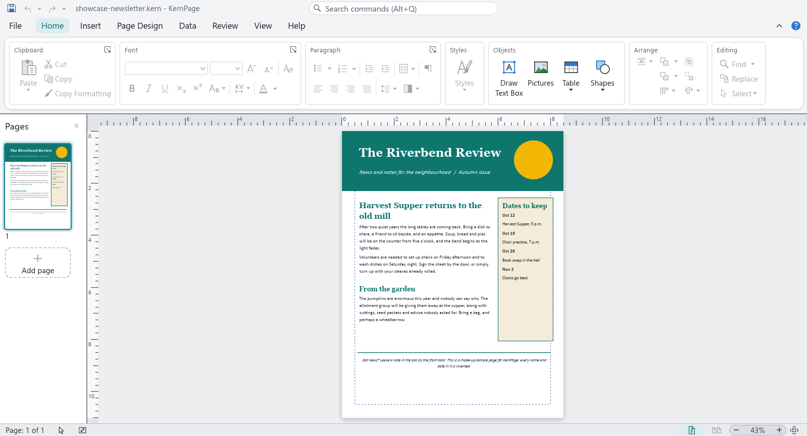
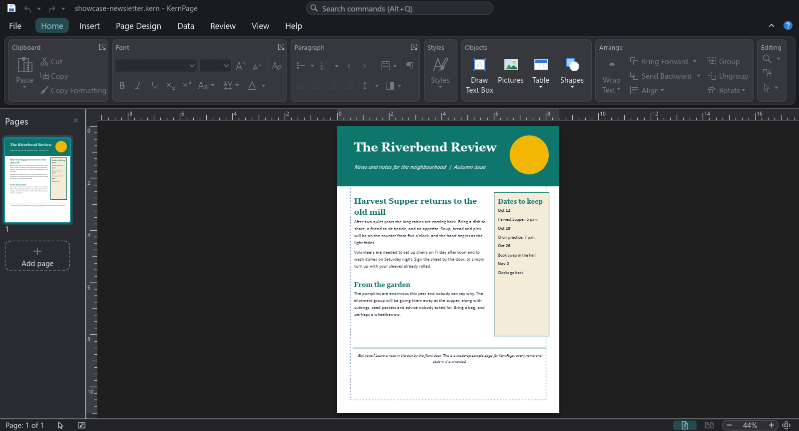
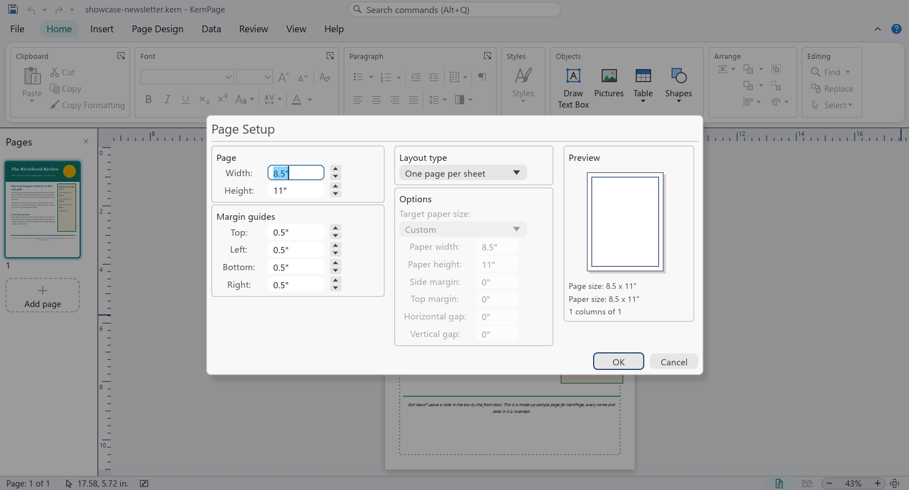
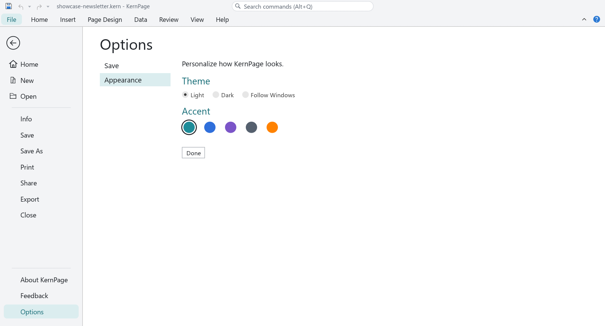

<h1 align="center">
  <picture>
    <source media="(prefers-color-scheme: dark)" srcset="brand/teal/kernpage-wordmark-dark.png">
    
  </picture>
</h1>

<p align="center"><strong>Free, open-source desktop publishing for Windows: bulletins, newsletters, flyers, programs and posters.</strong></p>

<p align="center">
  <a href="https://github.com/jmitchell238/KernPage/releases/latest"></a>
  
  
  
</p>



KernPage is a free desktop publishing program for Windows. Lay out bulletins, newsletters, flyers,
programs and posters: place text, pictures, tables and shapes on the page, then print it or save it as
a PDF. No account, no subscription, no telemetry, and the source is yours to read.

KernPage is made to replace Microsoft Publisher for people who used it before. Microsoft retired
Publisher in October 2026, and a lot of bulletins, newsletters, flyers and programs are still sitting
in `.pub` files, so KernPage opens those files, lets you change them, and saves the result back into
the same `.pub` file (it also has its own `.kern` format).

KernPage is early software. It already does the everyday basics (see below), and it says plainly what
it cannot do yet, so you can decide whether it fits a job today.

KernPage is an independent project. It is not affiliated with, endorsed by or sponsored by Microsoft. Microsoft, Publisher, Office and Windows are trademarks of the Microsoft group of companies.

## What you can do today

**Open and keep your files**
- Open `.pub` files saved by Publisher 2003 through 2021: text with fonts and formatting, shapes,
  pictures, tables, groups, rotation, text wrap, columns and linked text boxes.
- Save back into the same `.pub` file. We check the files KernPage writes by opening them in
  Publisher 2021 on our own machines.
- Saves in its own open format (`.kern`, described in [docs/spec/KERN-FORMAT.md](docs/spec/KERN-FORMAT.md)) and opens/saves Publisher `.pub` files.
- AutoRecover and crash recovery, with the interval under File > Options.

**Edit**
- Type and format text: font, size, bold, italic, underline, colour, alignment, spacing, superscript
  and subscript, bullets and numbering, Clear Formatting.
- Move, resize and rotate objects, flip lines; fill and outline; text wrap; text box columns; stacking
  order; group and ungroup; align.
- Linked text boxes: text flows from one frame to the next, with overflow marks.
- Insert tables (add and delete rows and columns, edit cell text), pictures (insert, replace,
  delete), text boxes, rectangles, ovals and lines.
- Add, move, duplicate and delete pages; Page Setup for size, orientation and margin guides.
- Undo and redo, rulers, a Pages pane, right-click menus and command search (Alt+Q).

**Look and output**
- A ribbon-style window with tabs, groups and a File screen, using KernPage's own icons and colours.
  Light, Dark or Follow Windows themes, five accent colours (Teal, Blue, Purple, Graphite, Orange), all under
  File > Options > Appearance.
- Create a PDF, and print straight to a printer you choose.
- **KernPage Launcher**, a small companion program that opens KernPage and your recent files, checks
  for signed updates and can go back to an older version.

- Master pages and page numbers from opened files are shown, printed and kept when you save
  (editing master pages comes later).

**Not there yet:** editing master pages, styles, text box margins and autofit, spell check, data-driven publishing (the Data tab is shown as a mock-up), more templates, fill effects, Package for Printing, and many ribbon commands that are shown greyed out. Every feature we track
is listed in [docs/FEATURES.md](docs/FEATURES.md), and [ROADMAP.md](ROADMAP.md) shows the plan.

## Screenshots

| Dark theme |
|---|
|  |

| Page Setup | File > Options > Appearance |
|---|---|
|  |  |

The pictures show an invented sample newsletter (`samples/kern/showcase-newsletter.kern`); every name and
date in it is made up.

## Download and install

Download **`KernPage-<version>-Setup.exe`** from the
[latest release](https://github.com/jmitchell238/KernPage/releases/latest) and run it. It installs just
for you, needs no administrator rights, and puts KernPage and the KernPage Launcher in the Start menu.
KernPage shows up under **Open with** for `.pub` files and never takes over double-click from another program.
Windows will warn about an unknown publisher the first time, because KernPage isn't code-signed yet;
that is expected.

**Step-by-step help with pictures: [INSTALL.md](INSTALL.md)**: which file to download, the Windows
warning, the installer screens, updating and uninstalling.

**Updates.** The KernPage Launcher checks a signed update list and verifies every download
(signature, SHA-256, exact size, HTTPS) before it installs anything. By default it only checks when you
press Check; see [PRIVACY.md](PRIVACY.md) for exactly what is sent. More detail, including silent installs, is in
[packaging/windows/INSTALLATION.md](packaging/windows/INSTALLATION.md).

## Build from source

Windows is the main platform. You need Rust (the project builds with the GNU toolchain,
`x86_64-pc-windows-gnu`, and MSYS2 UCRT64 gcc on the `PATH`). `rust-toolchain.toml` pins Rust 1.100.0 (run `rustup set default-host x86_64-pc-windows-gnu` once so rustup picks the GNU build); use `--locked` to build with the exact dependency versions in `Cargo.lock`.

```
cargo build --workspace --release
cargo test --workspace
cargo run --release -p kernpage -- samples/kern/showcase-newsletter.kern
cargo run --release -p kernpage-launcher
cargo run -p pubdump -- samples/hello.pub
cargo run -p pub2pdf -- samples/two-boxes.pub two-boxes.pdf
```

To build the installer, see [packaging/windows/INSTALLATION.md](packaging/windows/INSTALLATION.md).
To regenerate the sample newsletter: `cargo run -p kernpage-core --example make_showcase -- showcase-newsletter.pub`, then open it in KernPage and Save As `.kern`.

## What's here

| Path | What it is |
|---|---|
| `crates/kernpage` | The desktop editor (egui): ribbon, canvas, File screen, dialogs |
| `crates/kernpage-core` | Editable document model, commands with undo/redo, and the save planner; no GUI code |
| `crates/kernpage-launcher` | KernPage Launcher: open KernPage and recent files, signed updates |
| `kernicons` (crates.io) | The icon set, a separate project (MIT OR Apache-2.0, published separately), used as an ordinary dependency from crates.io |
| `crates/kernpage-release` | Release tool that signs the update list (not shipped in the installer) |
| `crates/pub-format` | Reads `.pub` files (Publisher 2003 to 2021) |
| `crates/pub-write` | Writes changes back into `.pub` files |
| `crates/pub2pdf` | Converts a publication to PDF (library and command-line tool) |
| `crates/pubdump` | Command-line tool that prints what is inside a `.pub` file |
| `crates/metafile` | Reads WMF/EMF pictures from their public specifications |
| `docs/` | [Feature catalogue](docs/FEATURES.md), [format description](docs/spec/PUB-FORMAT-SPEC.md), design and research notes, [release process](docs/RELEASING.md) |
| `packaging/windows/` | Windows installer (WiX MSI and Setup.exe) |
| `samples/` | Test and sample files (sources and licences in `samples/SOURCES.md`) |
| `tools/` | Small scripts used to study the format |

## Project status

Early development: version 0.2.4 is released (see the [latest release](https://github.com/jmitchell238/KernPage/releases/latest) and [docs/release-notes/0.2.4.md](docs/release-notes/0.2.4.md)). See
[ROADMAP.md](ROADMAP.md) for what is done and what is next, and [docs/FEATURES.md](docs/FEATURES.md)
for the feature-by-feature list. Contributions are welcome: see [CONTRIBUTING.md](CONTRIBUTING.md).
Security reports: [SECURITY.md](SECURITY.md). Privacy: [PRIVACY.md](PRIVACY.md).

## Logo and brand

The logo, a K whose stem is a rolled spine and whose arms are pages, comes as transparent marks (the K alone and the full
wordmark) for light and dark backgrounds in all five accent colours, plus recolourable SVG masters. See
[brand/README.md](brand/README.md) for the files, the colour table and when to use each.

## How this was built

The `.pub` format description in `docs/spec` is written in our own words, from files we created
ourselves, from comparing the files Publisher writes after known edits made through its public automation interface, and from Microsoft's published Open Specifications (for example [MS-ODRAW]). The code is
written from that description. We do not use Microsoft code, icons, artwork or templates.
KernPage is an independent project. It is not affiliated with, endorsed by or sponsored by Microsoft. Microsoft, Publisher, Office and Windows are trademarks of the Microsoft group of companies.

## Support KernPage

KernPage is free and always will be. If it helps you, you can say thanks at
[buymeacoffee.com/238apps](https://buymeacoffee.com/238apps) (also under File > About KernPage).
Reporting problems and sharing ideas helps just as much.

## Licence

KernPage is licensed under the [GNU General Public License, version 3 only](LICENSE) (GPL-3.0-only).

Versions up to and including 0.2.0 were released under MIT OR Apache-2.0 and remain available under those
terms at the [v0.2.0 tag](https://github.com/jmitchell238/KernPage/tree/v0.2.0).

Contributions are accepted under the GPL-3.0 and the [Contributor Licence Agreement](CLA.md); see
[CONTRIBUTING.md](CONTRIBUTING.md).

Third-party licences: [THIRD_PARTY_NOTICES.md](THIRD_PARTY_NOTICES.md).

The icons come from Kernicons, the icon set of KernPage by the same author (published separately under MIT OR Apache-2.0).
